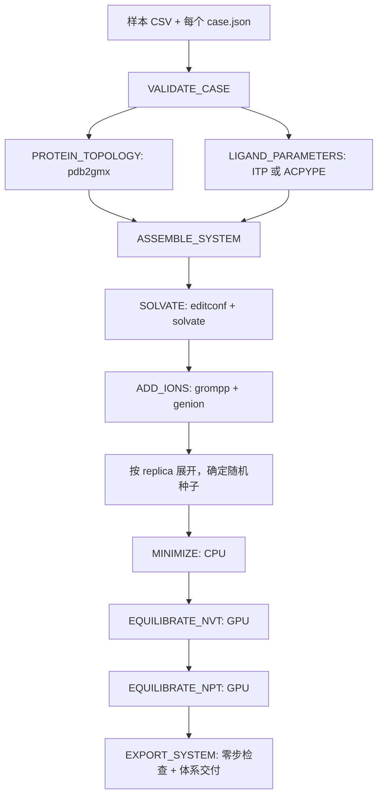

# AutoMdBuilder Nextflow v0.1

目标：**在 Slurm 上按 case 并行建系，按 replica 并行完成 EM → NVT → NPT，输出可追溯的 MD 体系**。本版不执行生产模拟、不做结合机制判断。

入口是仓库根目录 `main.nf`；推荐通过 `bin/launch.py` 启动。原有 `projects/` 和 `scripts/` 保留，新的流程不调用其中会清空 `replica_*` 的脚本。

## 1. 支持范围与输入边界

- 水溶性蛋白、蛋白 + 单配体、蛋白 + 多种/多个配体；蛋白可包含多条链。
- 两种配体模式可以在同一 case 混用：`itp` 接收已有 ACPYPE 拓扑；`acpype` 从显式含氢 MOL2 自动参数化。
- 复合物 PDB 必须已具有所需配体拷贝及坐标。**本版不重新随机放置配体、不修补缺失蛋白残基、不推断配体质子化/互变异构体**。已有随机放置工具的输出可以成为本流程输入。
- 需要明确净电荷；ACPYPE 默认 GAFF2 / AM1-BCC，闭壳层单重态。开壳层、金属配位、共价配体不在本版自动处理范围。
- 使用内置 Amber 蛋白力场 + TIP3P；默认 Amber99SB-ILDN。没有将 GAFF 配体直接拼到 CHARMM 拓扑的选项。
- 膜蛋白、Amber/TLEaP 建系、MISATO 重建脚本没有接入本版。其压力耦合和准备逻辑需要单独设计；不要拿本版的各向同性水溶液协议直接用于脂双层。
- 不静默删除水、离子或其他 HETATM。未声明的非蛋白残基会失败，要求用户先决定保留还是移除。

## 2. 模块怎样串接



**case 间可并行；同一 replica 内由 channel 的文件依赖保证顺序。** 蛋白拓扑与配体参数没有互相依赖，可以同时准备；二者按完整 case metadata join 后才组装。加水/加离子只做一次，所有 replica 从同一建系结果出发。每个 replica 独立最小化，再用其固定种子生成 NVT 初速度。

| Nextflow process | 主要输入 | 主要输出 | 实现定位 |
|---|---|---|---|
| `VALIDATE_CASE` | case 目录、全局参数 | `validated/`：蛋白/复合物输入、配体源文件、`state.json` | `modules/build.nf`；`mdflow.py::validate` |
| `LIGAND_PARAMETERS` | validated | `ligands/`：ITP、汇总 atomtypes、按拓扑顺序排列的配体坐标、约束、来源记录 | `mdflow.py::prepare_ligands` |
| `PROTEIN_TOPOLOGY` | validated | `protein/`：蛋白 PDB、`topol.top`、ITP | `mdflow.py::protein_topology` |
| `ASSEMBLE_SYSTEM` | 同一 case 的 protein + ligands | `assembled/`：复合物 PDB、完整 include 拓扑 | `mdflow.py::assemble` |
| `SOLVATE` | assembled | `solvated/`：盒子、水、更新后的拓扑 | `mdflow.py::solvate` |
| `ADD_IONS` | solvated、ions MDP | `ionized/`：中和及加盐后的坐标/拓扑 | `mdflow.py::ions` |
| `MINIMIZE` | ionized、replica metadata、EM MDP | `em/`：坐标、TPR、能量、日志 | `modules/equilibrate.nf`；`mdflow.py::run_stage` |
| `EQUILIBRATE_NVT` | em、NVT MDP、固定 seed | `nvt/`：坐标、CPT、TPR、温度曲线 | 同上，`--stage nvt` |
| `EQUILIBRATE_NPT` | nvt（含 CPT）、NPT MDP | `npt/`：坐标、CPT、TPR、温度/压力/密度曲线 | 同上，`--stage npt` |
| `EXPORT_SYSTEM` | npt | `system/`：下游接口见第 6 节 | `mdflow.py::export_system` |

表中每个阶段目录携带后续需要的拓扑和前阶段记录，使用任务私有副本。它们留在 Nextflow `work/` 下，不会回写原始 case。平衡默认不输出坐标轨迹，控制大批量建系的磁盘占用；仍保存 GRO/CPT/EDR/日志。

配体在每个 case 内逐种参数化；不同 case 并行。v0.1 不跨 case 自动共用配体计算缓存，避免把名字相同但化学状态不同的配体当成同一个。大规模重复配体可先做一次 ACPYPE，再将验证过的 ITP 以 `itp` 模式复用。

## 3. 输入格式

样本 CSV 路径相对于当前命令；`case_dir` 相对于 CSV 所在目录，也可写绝对路径。

```csv
case_id,case_dir,replicas
apo_001,cases/apo_001,3
complex_001,cases/complex_001,5
```

`case_id` 必须唯一，只含字母、数字、下划线、点、短横线；`replicas` 为正整数。最简单的纯蛋白 case：

```text
cases/apo_001/
├── case.json
└── protein.pdb
```

```json
{"schema_version": 1, "structure": "protein.pdb", "ligands": []}
```

多配体 case 示例：

```json
{
  "schema_version": 1,
  "structure": "complex.pdb",
  "ligands": [
    {
      "id": "LGA", "resname": "LGA", "count": 10,
      "mode": "acpype", "mol2": "ligands/LGA.mol2",
      "charge": 0, "atom_type": "gaff2", "charge_method": "bcc"
    },
    {
      "id": "LGB", "resname": "LGB", "count": 5,
      "mode": "itp", "itp": "ligands/LGB_GMX.itp"
    }
  ]
}
```

所有 case 内部文件路径均相对于 case 目录，不允许 `../` 或符号链接指向目录之外。每种配体有唯一 PDB `resname`，每个拷贝为一个残基，以 `(chain, resseq, insertion code)` 区分。坐标中的氢原子必须完整；残基中的原子名必须唯一。

ACPYPE 的 MOL2 应为**单个配体分子**，其残基名和原子名与 PDB 对应；实际执行：

```bash
acpype -i input.mol2 -b LGA -n 0 -a gaff2 -c bcc -o gmx
```

参数化后检查 `[ atoms ]` 和各拷贝的 PDB 原子集合，并按拓扑的原子名顺序重排坐标。不能匹配时失败，不靠猜测改名或补氢。ITP 必须是独立的单分子 ACPYPE 文件，含明确质量，不能含外部 include、条件宏、已有 position_restraints 或未支持的全局段。重原子位置约束由流程统一生成。

多个配体的 atomtypes 相同且定义相同时合并；同名却参数不同会失败。最终 GROMACS `grompp -maxwarn 0` 再检查体系拓扑。

可选 `"box_nm": [10.0, 10.0, 10.0]` 指定盒边长；不指定时采用立方盒及 `padding_nm`。显式盒子会检查坐标跨度与溶剂余量。**PDB/MOL2 坐标为 Å，盒子参数为 nm。**

## 4. 参数与协议

全局默认值在 `nextflow.config`；MDP 模板在 `assets/mdp/`。覆盖参数可用 JSON/YAML 文件：

```json
{
  "temperature_k": 303.15,
  "salt_molar": 0.15,
  "padding_nm": 1.2,
  "nvt_ps": 500.0,
  "npt_ps": 500.0,
  "dt_ps": 0.002,
  "em_steps": 50000,
  "em_tolerance": 1000.0,
  "seed": 20241126,
  "cpus": 8,
  "memory": "16 GB",
  "time": "12h",
  "queue_size": 100
}
```

与旧脚本相比，这里明确做了协议整理，**不是逐项复刻旧 MDP**：

| 项目 | 本版默认 | 理由/边界 |
|---|---|---|
| 蛋白/水 | Amber99SB-ILDN / TIP3P | 对应原多配体主路线 |
| EM | steep，最多 50000 步，Fmax < 1000 kJ mol⁻¹ nm⁻¹ | 必须达到力阈值，未收敛不进入平衡 |
| NVT | 500 ps，2 fs，v-rescale | 不沿用旧 Berendsen thermostat |
| NPT | 500 ps，2 fs，v-rescale + C-rescale，1 bar，各向同性 | 水溶液初步平衡；不用于膜体系 |
| 温度耦合组 | System | 避免小配体/离子构成不合适的小温控组 |
| 位置约束 | 蛋白与配体重原子，1000 kJ mol⁻¹ nm⁻² | NVT/NPT 都使用 EM 末态作参考 |
| replica seed | SHA256(base seed, case_id, replica) 映射为正整数 | 改变并发数/调度顺序不改变种子；不承诺硬件间逐位一致 |
| 警告 | grompp `-maxwarn 0` | 不自动吞掉物理/拓扑警告 |

`pdb2gmx -ignh` 重新生成蛋白氢原子，端基/HIS 等采用 GROMACS 的非交互默认规则。输入蛋白必须先完成链、构建体、端基、二硫键及质子化审查；本版不声称对所有蛋白自动选对化学状态。需要特殊人工选择的体系应先扩展明确的输入协议，不能将交互提示随意重定向为固定数字。

完成检查包括：正常退出、坐标/原子数有效、EM 收敛、NVT/NPT 达到目标步数、没有捕获到的 LINCS/SHAKE/NaN 错误、checkpoint 存在。**这些是数值与文件完整性门槛，不等于物理平衡或充分采样**；`manifest.json` 的 `scientific_equilibration_verified` 始终为 false。

## 5. 本地、Slurm 和环境迁移

环境构建见 [environments/README.md](../../environments/README.md)。固定 Nextflow 24.10.4，GROMACS **2024.4**（运行时拒绝其他年份），ACPYPE 2023.10.27。推荐 Linux x86_64 + Apptainer；SIF 和 shared work 目录必须在计算节点可见。

```bash
# 在集群登录节点执行；不要在工作站运行后期待 Nextflow 自动通过 SSH 提交。
python3 bin/launch.py \
  --samples /shared/md-input/samples.csv \
  --outdir /shared/md-output/batch001 \
  --work-dir /shared/md-work/batch001 \
  --executor auto --runtime apptainer \
  --gmx-image /shared/containers/gromacs-2024.4-cuda12.4.sif \
  --acpype-image /shared/containers/acpype-2023.10.27.sif \
  --params-file /shared/md-input/params.json
```

自动选择顺序：

1. `sbatch/squeue/scancel/sinfo` 存在且能查询 `gpu` 分区 → Slurm。
2. 否则本机存在可见 NVIDIA GPU → `local_gpu`，**全局队列长度为 1**，包括不同 process 类型也不重叠。
3. 两者均无 → 在提交任何真实任务前退出。可显式使用 `--stub-run`。

显式 `--executor slurm` 不允许降级；本地模式用 `--executor local`。自动选择只发生在启动前。已经排入 Slurm 的任务失败/集群中断时不会转到本地继续，避免重复作业。没有远程 SSH、密码或集群登录配置。

默认所有任务进入 `gpu` 分区；仅 NVT/NPT 请求 `--gres=gpu:a40:1`，每任务单节点、单 GPU、8 CPU，EM 使用 CPU。设置 `CUDA_VISIBLE_DEVICES` 由 Slurm 管理，不硬编码 `-gpu_id 0/1`。没有外部 MPI；GROMACS 使用 thread-MPI，`-ntmpi 1`。NVT/NPT 将短程非键相互作用放到 GPU，PME/update 留在 CPU，先确保保守兼容性。

分区 GPU 类型命名是站点约定，若实际 GRES 名称不同，使用 `--gres` 覆盖。如果该分区禁止 CPU-only job，可通过 `--config conf/site.example.config` 的副本将准备/EM 移到其他分区，或为其申请站点要求的资源。账户/QOS 等同样在站点配置设置。

同样命令在无法访问 Slurm 的 Linux NVIDIA 工作站会串行运行。CUDA 容器不支持在 macOS/Apple GPU 或 AMD GPU 上真实运行；没有把“检测到任意 GPU”误当成 CUDA 可用。

恢复原批次：重复相同命令并加 `--resume`。保留 work 和输出目录内 `.nextflow/` 缓存；完成阶段按 Nextflow 缓存复用，失败阶段重新执行。**v0.1 是阶段级恢复，不是在失败 NPT 的中途用 CPT 续跑**。CPT 用于正常 NVT→NPT 衔接及最终交付。

## 6. 给后续生产模拟保留的接口

```text
results/
├── run_inputs.json                 # 输入/配置/代码指纹，SIF SHA256（使用 Apptainer 时）
├── launch-*.json / status-*.json    # 每次启动及退出状态
├── cases-*.csv                     # 所有请求的 case/replica，含 NOT_COMPLETED
├── pipeline_info/                  # 每次运行独立 trace/report/timeline/DAG
└── systems/<case_id>/replica_<n>/system/
    ├── manifest.json
    ├── equilibrated.gro
    ├── equilibrated.cpt
    ├── equilibration.tpr
    ├── system.top
    ├── restraint_reference.gro
    ├── topology/                   # 重新平衡用的 include 拓扑（仍依赖相同内置力场）
    └── provenance/                 # MDP、命令、日志、能量曲线、配体参数来源
```

`artifact_schema = "automdbuilder.system.v1"` 是后续流程入口；读取 `manifest.files`，不要靠 glob 猜文件。消费端应要求 `status == "equilibrated"`、`simulation_executed == true`，并验证 `sha256`。`system.top` 是 `grompp -pp` 展开的完整拓扑，**POSRES 已关闭**，不再把完整拓扑命名成 `processed.itp`。

`equilibrated.cpt` 来自受约束 NPT；`equilibration.tpr` 描述受约束平衡过程，**不是生产 TPR**。下游必须自行选择生产 MDP、温压耦合与是否继续约束；需要保留约束时使用 `topology/` 并遵循相同 GROMACS/力场环境。默认交付的平坦 `system.top` 不携带活跃位置约束。

导出时只进行 `nsteps=0` 的 grompp 编译校验，不执行该检查 TPR。生产模拟、分析或提交其他计算平台的代码没有实现。

## 7. 失败、定位与重跑

- 普通输入/参数化/数值失败：该 task 标为失败，其依赖链停止；其他 case/replica 继续。最后整体退出码仍为非零（`workflow.failOnIgnore = true`）。
- 137/140/143 等资源/终止类退出码最多重试两次；不对科学性错误反复重试，也不会用 `maxwarn` 绕过错误。
- `cases-*.csv` 列出未完成 replica；trace TSV 给出 process 名称、状态、退出码和 work hash。结合 `.nextflow.log` 定位工作目录，再看 `.command.err`、`.command.log` 和阶段内 `*.command.log`。
- `execute()` 使用参数列表调用外部程序，不拼接 shell；命令保存在 `commands.jsonl`。
- 输入原件从不改写。启动器拒绝非空输出目录，除非显式 `--resume` 且输入/参数/代码/镜像指纹匹配。修改协议或输入时使用新的 outdir；不要将新旧体系混在一起。
- 下一次仅重跑失败 case 可从原 samples CSV 筛选，写一个新的 CSV 与新的 outdir。原失败 work 目录保留作诊断。
- 每个输出文件在 manifest 中记录 SHA256。输入校验值也会随体系保存。

## 8. 当前验证范围

无 GPU 本机可以运行：

```bash
PYTHONDONTWRITEBYTECODE=1 python3 -m unittest discover -s tests -p 'test_*.py' -v
python3 bin/launch.py --samples tests/fixtures/samples.csv \
  --outdir tests/output/my-stub --work-dir tests/output/my-stub-work --stub-run
python3 tests/run_workflow_tests.py --nextflow /path/to/nextflow --outdir tests/output/my-suite
```

`tests/fixtures` 是合成的软件测试输入，**不能用于真实 MD**。stub 仅执行输入校验，后续输出标记为 `STUB_ONLY`，没有可用 GRO/TPR。完整命令测试使用要求显式环境开关的 fake GROMACS/ACPYPE，验证命令连接、拓扑处理、导出、失败隔离和 resume，不验证力场、GPU 内核或物理结果。

迁移后先用一个经过人工检查的小体系和一个 replica 做真实验收：容器版本 → ACPYPE → grompp 零警告 → EM 收敛 → NVT/NPT 完成 → 温度/密度/能量及结构检查 → 展开拓扑验证 → 下游能够读入交付目录。通过后再放大样本数。应另外模拟一次 Slurm 中断以验证该站点的退出码、重试与缓存行为。

实现参考：[Nextflow executor](https://www.nextflow.io/docs/stable/executor.html)、[缓存与恢复](https://www.nextflow.io/docs/stable/cache-and-resume.html)、[GROMACS 2024.4 grompp](https://manual.gromacs.org/documentation/2024.4/onlinehelp/gmx-grompp.html)、[MDP 参数](https://manual.gromacs.org/documentation/2024.4/user-guide/mdp-options.html)、[ACPYPE 2023.10.27 CLI](https://github.com/alanwilter/acpype/blob/2023.10.27/acpype/parser_args.py)。
